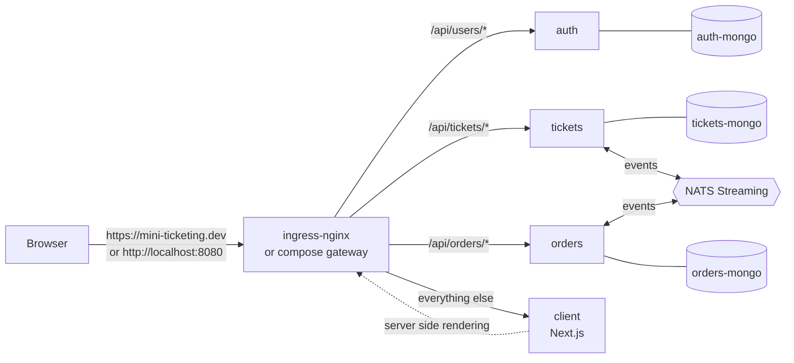

# Mini Ticketing 🎟️

A small, but genuinely microservice, ticketing app. It's built the same way as the course **Ticketing** app (same folder layout, `common` package, NATS Streaming events, a MongoDB per service, a Next.js client with `build-client.js` + `use-request`, `infra/k8s` + Skaffold, ingress-nginx), just trimmed down.

People can **sign up / sign in, list tickets, sell (create) a ticket, and buy a ticket** end to end.

What's left out compared to the course app: the `expiration` service, the separate `payments` service and Stripe (payment is a **mock** "Pay" button in the orders service), and most of the tests.

---

## Architecture



* Every backend service owns **its own MongoDB**. No service ever reads another service's database.
* Services never call each other over HTTP. They talk **only through events on NATS Streaming** (`nats-streaming:0.17.0` + `node-nats-streaming`, same as the course).
* `orders` keeps its **own replicated copy of tickets** (only `title`, `price`, `version`) built from `ticket:created` / `ticket:updated` events.
* Auth is a **JWT inside a cookie-session cookie**. Every service checks it itself with the shared `currentUser` middleware, so `auth` doesn't need to be up for the others to know who you are.

### Services

| Service | Port | Routes | Database | Publishes | Listens for |
|---|---|---|---|---|---|
| **auth** | 3000 | `POST /api/users/signup`, `POST /api/users/signin`, `POST /api/users/signout`, `GET /api/users/currentuser` | auth-mongo | – | – |
| **tickets** | 3000 | `GET /api/tickets`, `GET /api/tickets/:id`, `POST /api/tickets`, `PUT /api/tickets/:id` | tickets-mongo | `ticket:created`, `ticket:updated` | `order:created` (lock ticket), `order:cancelled` (unlock ticket) |
| **orders** | 3000 | `GET /api/orders`, `GET /api/orders/:orderId`, `POST /api/orders` (buy / reserve), `POST /api/orders/:orderId/pay` (mock payment), `DELETE /api/orders/:orderId` (cancel) | orders-mongo | `order:created`, `order:cancelled` | `ticket:created`, `ticket:updated` (replicate tickets) |
| **client** | 3000 | Next.js pages: `/`, `/auth/signup`, `/auth/signin`, `/auth/signout`, `/tickets/new`, `/tickets/[ticketId]`, `/orders`, `/orders/[orderId]` | – | – | – |

### Events

| Subject | Published by | Consumed by | Data | Why |
|---|---|---|---|---|
| `ticket:created` | tickets | orders | `id, version, title, price, userId` | orders saves its own copy of the ticket |
| `ticket:updated` | tickets | orders | `id, version, title, price, userId, orderId?` | keeps the copy in sync (processed strictly in version order) |
| `order:created` | orders | tickets | `id, version, status, userId, ticket { id, price }` | tickets **locks** the ticket (`orderId` set) so it can't be edited or bought twice |
| `order:cancelled` | orders | tickets | `id, version, ticket { id }` | tickets **unlocks** the ticket |

Concurrency is handled like the course: `mongoose-update-if-current` + `versionKey: "version"`, and orders' `Ticket.findByEvent()` only applies an update if it is the *next* version. If an event arrives out of order, the listener doesn't `ack()` and NATS re-sends it after 5 seconds.

---

## Folder structure

```
mini-ticketing/
├── common/            Shared code: errors, middlewares, base Listener/Publisher, event interfaces, Subjects, OrderStatus
├── auth/              Express + TS: users, signup/signin/signout/currentuser (+ jest/supertest tests)
├── tickets/           Express + TS: tickets CRUD, publishes ticket events, locks tickets on order events
├── orders/            Express + TS: buy (create order), mock pay, cancel, replicated tickets
├── client/            Next.js (pages router), build-client.js, use-request hook, Header
├── infra/k8s/         Namespace, deployments + ClusterIP services, mongo per service, NATS, ingress
├── gateway/nginx.conf Tiny nginx gateway for docker-compose (plays the ingress-nginx role)
├── skaffold.yaml      Skaffold v2 (apiVersion skaffold/v4beta11)
├── docker-compose.yml Quick local run without Kubernetes
├── .env.example       Template for the compose JWT_KEY (copy to .env, never commit .env)
└── package.json       Helper scripts only (setup / typecheck)
```

---

## How `common` is shared (no npm publishing)

In the course, `common` is published to npm as `@sm-ticketing-library/common` and every service installs it from the registry. Here it's **consumed locally**:

1. Every service has `"@mini-ticketing/common": "file:../common"` in its `package.json`.
2. Every service has an `.npmrc` with `install-links=true`. This makes npm install `common` as a **real copy** inside the service's `node_modules` (instead of a symlink). That matters because:
   * `common`'s dependencies (express, node-nats-streaming, jsonwebtoken…) get de-duplicated with the service's own copies, so there's only one `express`, and the global `req.currentUser` typing works.
   * It works exactly the same on Windows, in Docker and in Kubernetes. No symlinks to break.
3. The backend Dockerfiles use the **repo root as the build context** (`context: .` in `skaffold.yaml` and `docker-compose.yml`), so they can `COPY common/`, build it, and then `npm install` the service.

Why this and not the alternatives?
* *Publishing to npm* needs an account, versions, and a publish every time you change one line.
* *Copying `common/src` into each service* at build time works in Docker but breaks `tsc` and your editor locally.
* *A symlinked `file:` dependency* (npm's default) breaks in Docker builds and confuses module resolution.

**If you change something in `common`:** run `npm run refresh-common` inside each service (`auth`, `tickets`, `orders`). It rebuilds `common` and re-copies it (npm won't re-copy on its own because the version number didn't change). In Skaffold, a change to `common` triggers an image rebuild instead of a file sync.

---

## Prerequisites

Node 20+ (you have 21), Docker Desktop, and for the Kubernetes route: Kubernetes enabled in Docker Desktop, kubectl, Skaffold v2 and **ingress-nginx** installed (the same one from the course works).

First time only, install everything (builds `common` first, then the services and client):

```powershell
npm run setup
```

---

## Run it with Skaffold (Kubernetes)

1. **Hosts file.** Open `C:\Windows\System32\drivers\etc\hosts` as Administrator and add:
   ```
   127.0.0.1 mini-ticketing.dev
   ```
   (It's a different host and namespace from the course app's `ticketing.dev`, so the two never clash.)

2. **Namespace and JWT secret.** Create the secret by hand. It's never stored in the repo. Use your own long random string:
   ```powershell
   kubectl create namespace mini-ticketing
   kubectl create secret generic jwt-secret --from-literal=JWT_KEY=<your-own-long-random-string> -n mini-ticketing
   ```

3. **Start it:**
   ```powershell
   skaffold dev
   ```
   Changes to `*/src/**/*.ts` and the client's `*.js` are synced straight into the running pods (ts-node-dev / Next.js reload them).

4. Open **https://mini-ticketing.dev**. Chrome will warn about the self-signed certificate, so click anywhere on the page and type `thisisunsafe` (same as the course).

Useful: `kubectl get pods -n mini-ticketing`, `kubectl logs -n mini-ticketing deploy/orders-depl`. To remove everything, run `skaffold delete`.

> The cookie is `secure` (https only) in Kubernetes, exactly like the course app.

---

## Run it with docker-compose (quick, no Kubernetes)

```powershell
copy .env.example .env      # then edit .env and put your own random JWT_KEY in it
docker compose up --build
```

Open **http://localhost:8080**. The nginx `gateway` container routes `/api/users`, `/api/tickets` and `/api/orders` to the services and everything else to the client, the same rules as `ingress-srv.yaml`. Because this is plain http, compose sets `COOKIE_SECURE=false`. NATS monitoring is at http://localhost:8222/streaming.

Stop with `Ctrl+C`, then `docker compose down` (add `-v` to wipe the databases).

---

## Walkthrough: buying a ticket

1. **Sign up**: the client posts to `POST /api/users/signup`. auth hashes the password (scrypt), saves the user, signs a JWT and puts it in the session cookie.
2. **Sell a ticket** (*Sell Tickets*): `POST /api/tickets`. tickets saves it at `version 0` and publishes **`ticket:created`** → orders saves its own copy of the ticket.
3. **Browse**: the home page server-renders `GET /api/tickets` (through the ingress/gateway, forwarding your cookie).
4. **Buy** (another user clicks *Buy* on `/tickets/[ticketId]`): `POST /api/orders { ticketId }`.
   * orders looks the ticket up in **its own copy**, checks it isn't already reserved (an order in status `created` or `complete` exists), saves the order as **`created`** and publishes **`order:created`**.
   * tickets receives `order:created`, sets `orderId` on the ticket (**locked**: can't be edited, and the client shows *Reserved*), bumps the version, and publishes **`ticket:updated`**. orders then updates its copy to the new version.
   * A second buyer now gets `400 Ticket is already reserved`.
5. **Pay** (`/orders/[orderId]`, *Pay (mock)*): `POST /api/orders/:orderId/pay`. There's no card and no Stripe. orders checks that you own the order and that it isn't cancelled or already paid, then marks it **`complete`**. The ticket stays locked because it's sold.
6. **Or cancel**: `DELETE /api/orders/:orderId` marks it `cancelled` and publishes **`order:cancelled`**. tickets clears `orderId` and publishes `ticket:updated`, so the ticket is available again.
7. **My Orders** lists your orders with their status.

Try it with curl (compose):

```bash
curl -c me.txt -X POST localhost:8080/api/users/signup -H "Content-Type: application/json" -d "{\"email\":\"me@test.com\",\"password\":\"password\"}"
curl -b me.txt -X POST localhost:8080/api/tickets -H "Content-Type: application/json" -d "{\"title\":\"Concert\",\"price\":150}"
curl -b me.txt -X POST localhost:8080/api/orders -H "Content-Type: application/json" -d "{\"ticketId\":\"<ticket id>\"}"
curl -b me.txt -X POST localhost:8080/api/orders/<order id>/pay
```

---

## Tests

Only `auth` has tests (signup + currentuser, jest + supertest + mongodb-memory-server), like a starter set:

```powershell
cd auth
npm test          # watch mode, like the course
npm run test:ci   # run once
```

Type-check all the backend services: `npm run typecheck` (from the root).

## Secrets

* Kubernetes: `JWT_KEY` only comes from the `jwt-secret` secret you create with `kubectl create secret` (see above).
* Compose: `JWT_KEY` comes from your local `.env`, which is git-ignored. `.env.example` only has a placeholder.
* The only hard-coded key is a test-only value inside `auth/src/test/setup.ts`, used by jest.
